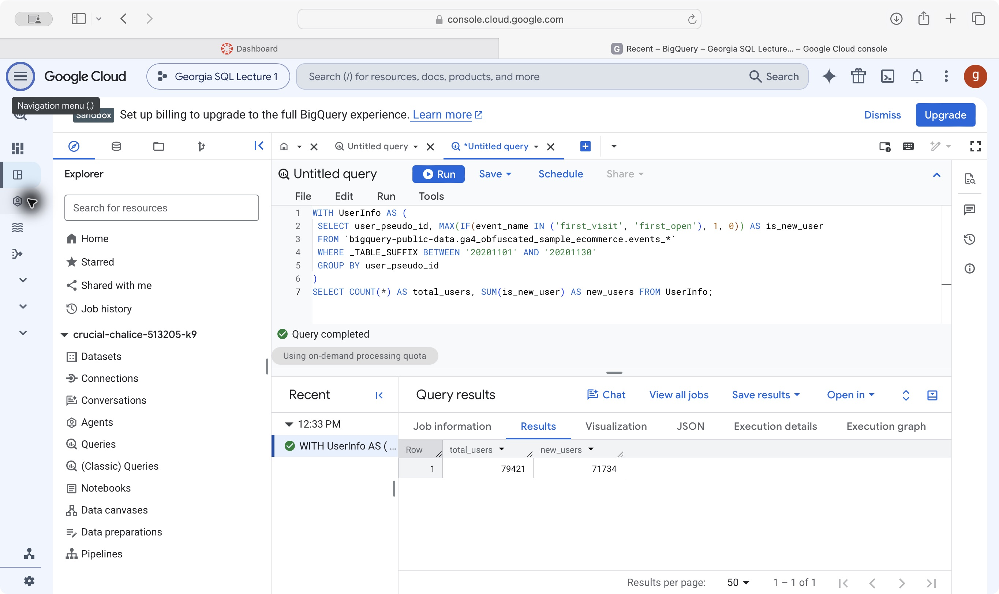
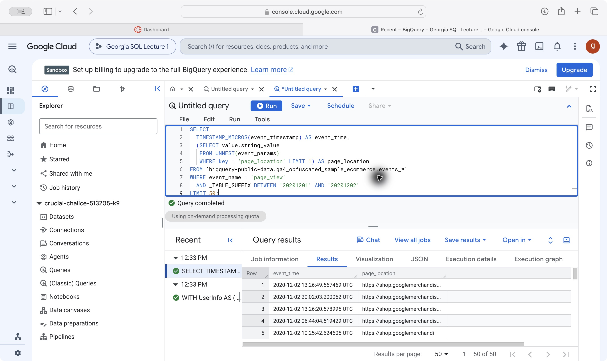
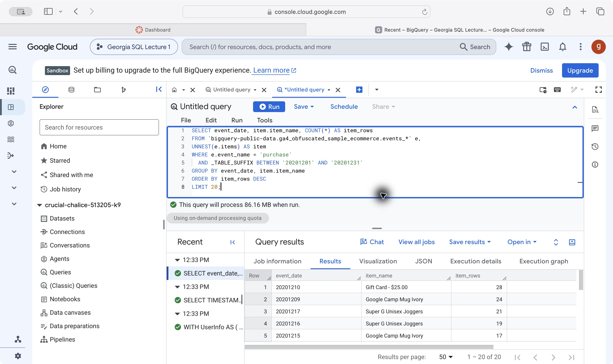
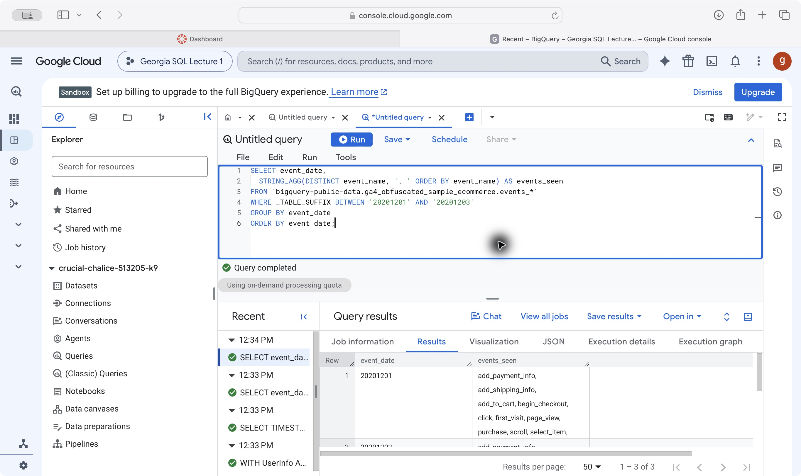
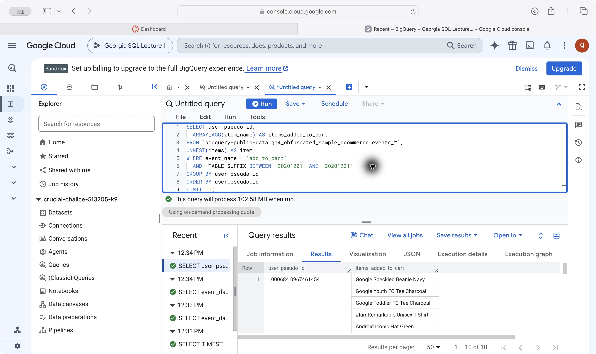
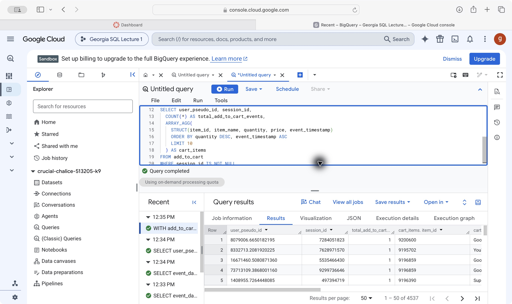
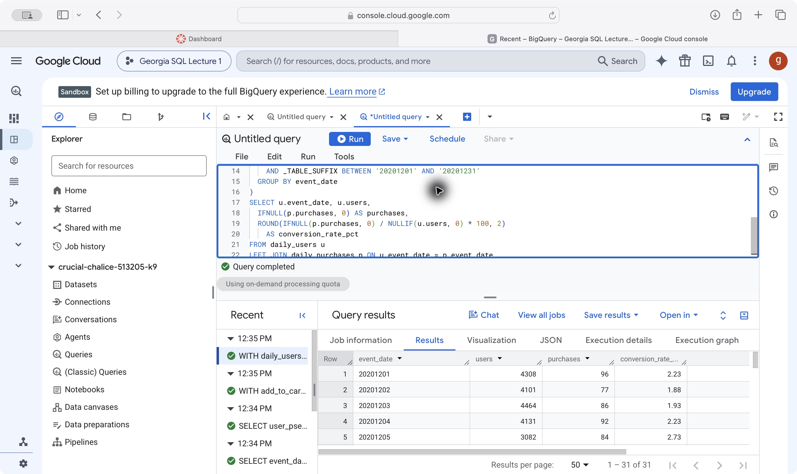
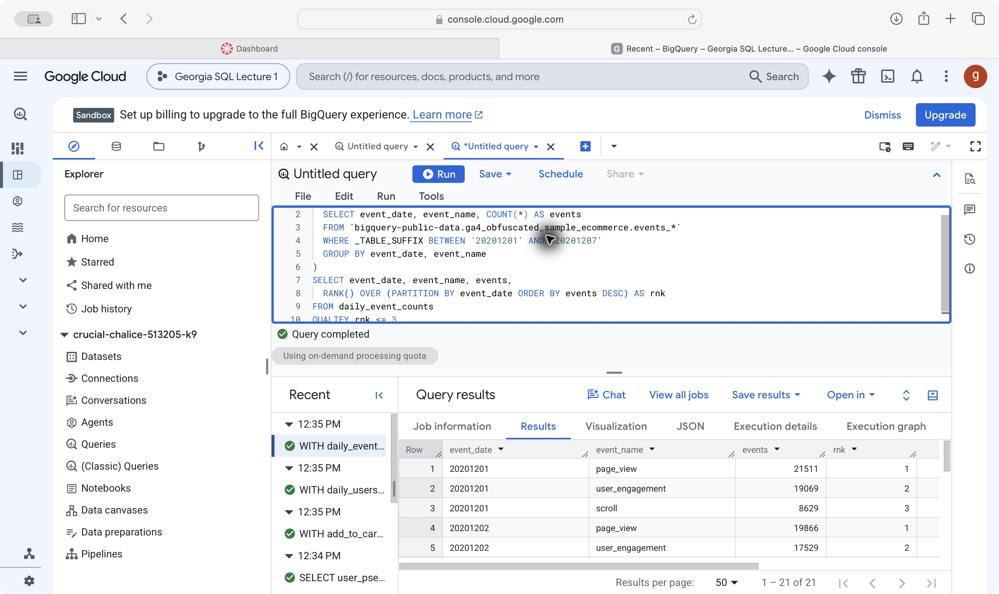
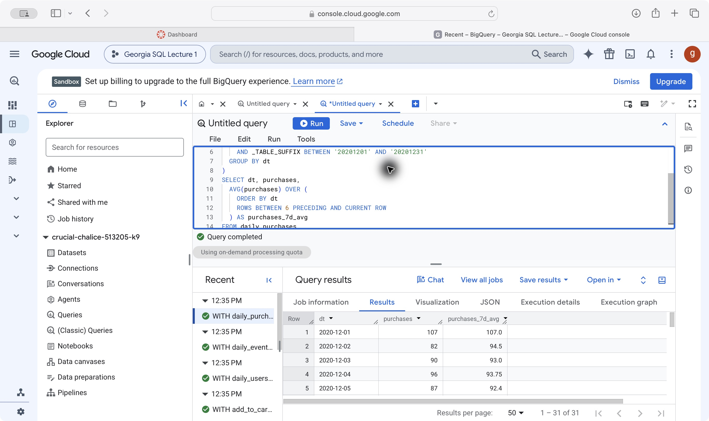
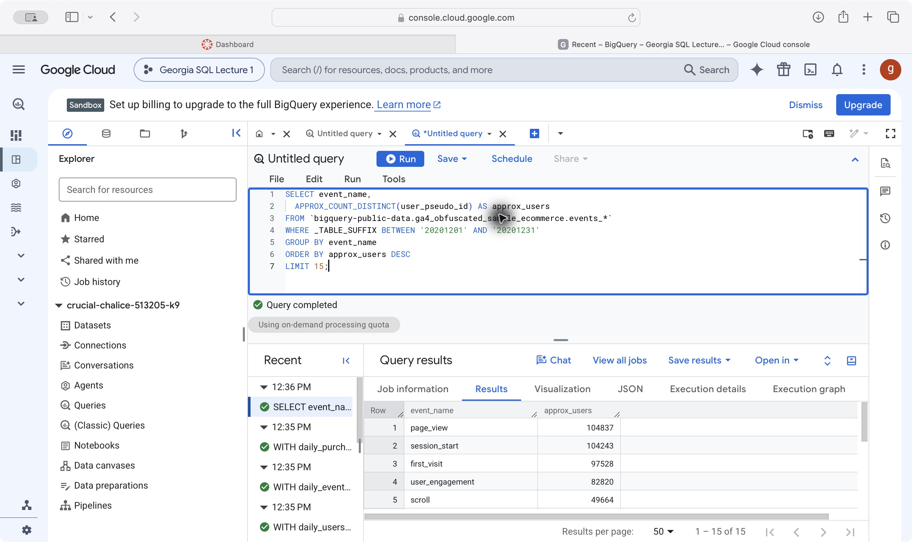

Ten lecture queries using the public GA4 ecommerce sample dataset, run successfully in BigQuery on November 4, 2026.

# CTEs

## Query 1: Total users and new users

`UserInfo` groups November 2020 events by user identifier and flags users with a `first_visit` or `first_open` event. The outer query counts all groups and sums the new-user flags.

```sql
WITH UserInfo AS (
  SELECT user_pseudo_id,
    MAX(IF(event_name IN ('first_visit', 'first_open'), 1, 0)) AS is_new_user
  FROM `bigquery-public-data.ga4_obfuscated_sample_ecommerce.events_*`
  WHERE _TABLE_SUFFIX BETWEEN '20201101' AND '20201130'
  GROUP BY user_pseudo_id
)
SELECT COUNT(*) AS total_users, SUM(is_new_user) AS new_users
FROM UserInfo;
```

{width=100%}

**Result:** 79,421 total user identifiers and 71,734 new-user identifiers; new users account for about 90.32%.

# Arrays and UNNEST

## Query 2: Extract page locations with a scalar subquery

This returns 50 page views from December 1–2, 2020. `TIMESTAMP_MICROS` converts timestamps, and a scalar subquery extracts `page_location` without adding rows.

```sql
SELECT
  TIMESTAMP_MICROS(event_timestamp) AS event_time,
  (SELECT value.string_value
   FROM UNNEST(event_params)
   WHERE key = 'page_location' LIMIT 1) AS page_location
FROM `bigquery-public-data.ga4_obfuscated_sample_ecommerce.events_*`
WHERE event_name = 'page_view'
  AND _TABLE_SUFFIX BETWEEN '20201201' AND '20201202'
LIMIT 50;
```

{width=100%}

**Result:** 50 page-view rows, with visible timestamps and Google Merchandise Store URLs. Repeated URLs represent separate events.

## Query 3: Flatten purchase items

`UNNEST` expands purchase items into separate rows. The query returns the 20 date/item groups with the most item records in December 2020; these counts are not units sold.

```sql
SELECT event_date, item.item_name, COUNT(*) AS item_rows
FROM `bigquery-public-data.ga4_obfuscated_sample_ecommerce.events_*` e,
UNNEST(e.items) AS item
WHERE e.event_name = 'purchase'
  AND _TABLE_SUFFIX BETWEEN '20201201' AND '20201231'
GROUP BY event_date, item.item_name
ORDER BY item_rows DESC
LIMIT 20;
```

{width=100%}

**Result:** Gift Card - $25.00 on December 10 leads with 28 item rows, followed by Google Camp Mug Ivory on December 9 with 24.

# STRING_AGG and ARRAY_AGG

## Query 4: List distinct event names by day

For December 1–3, `STRING_AGG` combines distinct event names into one alphabetically sorted string per day.

```sql
SELECT event_date,
  STRING_AGG(DISTINCT event_name, ', ' ORDER BY event_name) AS events_seen
FROM `bigquery-public-data.ga4_obfuscated_sample_ecommerce.events_*`
WHERE _TABLE_SUFFIX BETWEEN '20201201' AND '20201203'
GROUP BY event_date
ORDER BY event_date;
```

{width=100%}

**Result:** Three daily rows. December 1 includes cart, checkout, page-view, and purchase events; the list shows event types, not frequency.

## Query 5: Build an item-name array per user

`ARRAY_AGG` collects December cart item names for each user and returns 10 users. This groups by user, so one array can include several sessions and repeated item names.

```sql
SELECT user_pseudo_id,
  ARRAY_AGG(item_name) AS items_added_to_cart
FROM `bigquery-public-data.ga4_obfuscated_sample_ecommerce.events_*`,
UNNEST(items) AS item
WHERE event_name = 'add_to_cart'
  AND _TABLE_SUFFIX BETWEEN '20201201' AND '20201231'
GROUP BY user_pseudo_id
ORDER BY user_pseudo_id
LIMIT 10;
```

{width=100%}

**Result:** Ten user groups. The first array includes Google Speckled Beanie Navy and Google Youth FC Tee Charcoal.

## Query 6: Build a session cart summary

The CTE extracts session IDs and item details from matching 2021 tables. The query groups by user and session, excludes missing session IDs, and keeps up to 10 item records ordered by quantity, then timestamp. `COUNT(*)` counts item rows despite the event-count alias.

```sql
WITH add_to_cart AS (
  SELECT user_pseudo_id,
    (SELECT value.int_value FROM UNNEST(event_params)
     WHERE key = 'ga_session_id') AS session_id,
    TIMESTAMP_MICROS(event_timestamp) AS event_timestamp,
    i.item_id, i.item_name, i.quantity, i.price
  FROM `bigquery-public-data.ga4_obfuscated_sample_ecommerce.events_*`,
  UNNEST(items) AS i
  WHERE event_name = 'add_to_cart'
    AND _TABLE_SUFFIX BETWEEN '20210101' AND '20211231'
)
SELECT user_pseudo_id, session_id,
  COUNT(*) AS total_add_to_cart_events,
  ARRAY_AGG(
    STRUCT(item_id, item_name, quantity, price, event_timestamp)
    ORDER BY quantity DESC, event_timestamp ASC
    LIMIT 10
  ) AS cart_items
FROM add_to_cart
WHERE session_id IS NOT NULL
GROUP BY user_pseudo_id, session_id;
```

{width=100%}

**Result:** 4,537 user/session groups containing cart item details. These represent sessions with cart activity and a non-NULL session ID.

# Joins

## Query 7: Join daily users and purchases

Two CTEs count daily users and distinct transaction IDs for December 2020. `LEFT JOIN` retains dates from the user table; `IFNULL` fills missing purchase counts, and `NULLIF` prevents division by zero. The rate is transactions per 100 users, not the percentage of users who purchased.

```sql
WITH daily_users AS (
  SELECT event_date, COUNT(DISTINCT user_pseudo_id) AS users
  FROM `bigquery-public-data.ga4_obfuscated_sample_ecommerce.events_*`
  WHERE _TABLE_SUFFIX BETWEEN '20201201' AND '20201231'
  GROUP BY event_date
), daily_purchases AS (
  SELECT event_date,
    COUNT(DISTINCT
      (SELECT value.string_value FROM UNNEST(event_params)
       WHERE key = 'transaction_id')
    ) AS purchases
  FROM `bigquery-public-data.ga4_obfuscated_sample_ecommerce.events_*`
  WHERE event_name = 'purchase'
    AND _TABLE_SUFFIX BETWEEN '20201201' AND '20201231'
  GROUP BY event_date
)
SELECT u.event_date, u.users,
  IFNULL(p.purchases, 0) AS purchases,
  ROUND(IFNULL(p.purchases, 0) / NULLIF(u.users, 0) * 100, 2)
    AS conversion_rate_pct
FROM daily_users u
LEFT JOIN daily_purchases p ON u.event_date = p.event_date
ORDER BY u.event_date;
```

{width=100%}

**Result:** 31 daily rows. December 1 has 4,308 users and 96 transactions, or 2.23 transactions per 100 users.

# Window functions and QUALIFY

## Query 8: Rank the top event types each day

The CTE counts events by date and type for December 1–7. `RANK` orders event types within each day, and `QUALIFY` keeps ranks 1–3. Ties can produce more than three rows per day.

```sql
WITH daily_event_counts AS (
  SELECT event_date, event_name, COUNT(*) AS events
  FROM `bigquery-public-data.ga4_obfuscated_sample_ecommerce.events_*`
  WHERE _TABLE_SUFFIX BETWEEN '20201201' AND '20201207'
  GROUP BY event_date, event_name
)
SELECT event_date, event_name, events,
  RANK() OVER (PARTITION BY event_date ORDER BY events DESC) AS rnk
FROM daily_event_counts
QUALIFY rnk <= 3
ORDER BY event_date, rnk;
```

{width=100%}

**Result:** 21 rows. On December 1, page_view ranks first (21,511), user_engagement second (19,069), and scroll third (8,629).

## Query 9: Calculate a rolling purchase average

The query counts daily purchase events and averages the current row plus up to six preceding rows. Early dates use shorter windows. The window covers seven calendar days only when dates are consecutive.

```sql
WITH daily_purchases AS (
  SELECT PARSE_DATE('%Y%m%d', event_date) AS dt,
    COUNT(*) AS purchases
  FROM `bigquery-public-data.ga4_obfuscated_sample_ecommerce.events_*`
  WHERE event_name = 'purchase'
    AND _TABLE_SUFFIX BETWEEN '20201201' AND '20201231'
  GROUP BY dt
)
SELECT dt, purchases,
  AVG(purchases) OVER (
    ORDER BY dt
    ROWS BETWEEN 6 PRECEDING AND CURRENT ROW
  ) AS purchases_7d_avg
FROM daily_purchases
ORDER BY dt;
```

{width=100%}

**Result:** 31 daily rows. December 1 has 107 purchase events; December 2 has 82. Their two-day average is 94.5.

# Approximate functions

## Query 10: Estimate distinct users per event type

`APPROX_COUNT_DISTINCT` estimates users for each event type in December 2020 and returns the top 15. Users can appear in several event types, so these estimates should not be added together.

```sql
SELECT event_name,
  APPROX_COUNT_DISTINCT(user_pseudo_id) AS approx_users
FROM `bigquery-public-data.ga4_obfuscated_sample_ecommerce.events_*`
WHERE _TABLE_SUFFIX BETWEEN '20201201' AND '20201231'
GROUP BY event_name
ORDER BY approx_users DESC
LIMIT 15;
```

{width=100%}

**Result:** 15 event types. The highest visible estimates are page_view (104,837 users), session_start (104,243), and first_visit (97,528).

# Appendix

- [Published report](https://gmonjarrez.github.io/ibm-6500-sql-learning-portfolio/lecture2-ga4.html)
- [GitHub repository](https://github.com/gmonjarrez/ibm-6500-sql-learning-portfolio)
