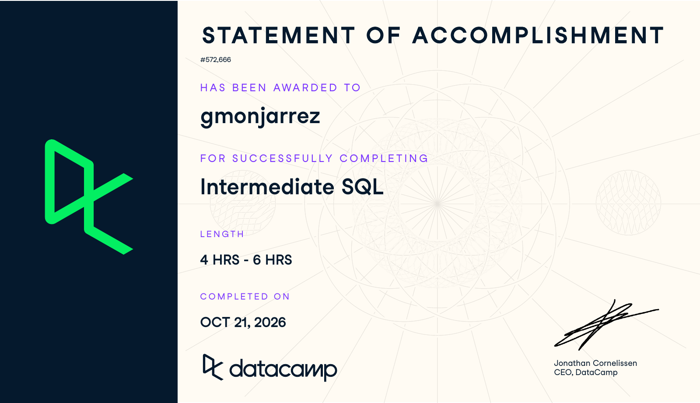

**Course:** IBM 6500 - Customer Insight Methods and Survey Research  
**Submission date:** October 21, 2026

# Course-Completion Evidence

I completed DataCamp's **Intermediate SQL** course on **October 21, 2026**, as recorded on the statement of accomplishment below. The statement identifies my account as **gmonjarrez**.

{width=100%}

# Learning Notes and Key Takeaways

These notes follow the four chapters and ten major lessons in the [DataCamp Intermediate SQL AI Tutor course outline](https://www.datacamp.com/courses/intermediate-sql): Data Aggregation, Data Transformation, Data Filtering, and Conditional Operations. The course exercises included a flights table; the examples below adapt that context into reusable query patterns.

**Example data:** `flights` represents one row per flight, with a unique, nonmissing `flight_id`. Fields used here are `airline`, `plane_type`, `flight_status`, `distance` in miles, `passengers`, `total_seats`, and `delay` in minutes. Examples assume these measures are numeric and distances and capacities are nonnegative. They illustrate query logic; they do not claim to reproduce results from DataCamp's full dataset. No private customer or survey records are included.

## Data Aggregation: Summary Values

**Main ideas:** Aggregation turns many records into a small set of summary measures. `COUNT(*)` counts rows; `COUNT(column)` counts nonmissing values; `COUNT(DISTINCT column)` counts different nonmissing values. `SUM`, `AVG`, `MIN`, and `MAX` summarize numeric values. Missing values are excluded from these numeric aggregates, so an average can have a smaller denominator than the row count.

**Important syntax:** `SELECT`, `FROM`, `COUNT(*)`, `COUNT(DISTINCT ...)`, `SUM(...)`, `AVG(...)`, `MIN(...)`, `MAX(...)`, and `AS` for readable output labels.

**When to use it:** Start with a summary when checking dataset size, coverage, or overall performance before comparing individual categories.

```sql
SELECT
    COUNT(*) AS flight_count,
    COUNT(DISTINCT airline) AS airline_count,
    SUM(passengers) AS total_passengers,
    AVG(distance) AS avg_distance,
    MIN(distance) AS shortest_distance,
    MAX(distance) AS longest_distance
FROM flights;
```

**Explanation and expected result:** This returns one summary row for the whole table. Passenger totals describe recorded passenger values, and average distance uses only flights with a known distance. An empty table produces zero counts and NULL for the other aggregates. Counting flights does not count unique travelers because a person could take multiple flights.

**CEP application:** For the Restaurant at Kellogg Ranch project, the same pattern could count survey responses and summarize observed spending or satisfaction. I would report the number of valid answers alongside each average and avoid treating the number of transactions as the number of customers.

## Data Aggregation: One Grouping Column

**Main ideas:** `GROUP BY` changes the level of a result from the whole table to one row per category. The grouping column identifies the category, while aggregate functions describe its records. Every selected field must either define a group or be summarized.

**Important syntax:** `GROUP BY airline`, aggregates in `SELECT`, and `ORDER BY ... DESC` to rank the output.

**When to use it:** Compare the same metric across airlines, campaigns, customer segments, or survey response categories.

```sql
SELECT
    airline,
    COUNT(*) AS flight_count,
    ROUND(AVG(delay), 2) AS avg_delay_minutes
FROM flights
GROUP BY airline
ORDER BY avg_delay_minutes DESC, airline;
```

**Explanation and expected result:** Each airline receives one row showing its flight count and average known delay, rounded to two decimal places. The secondary sort makes tied results easier to inspect. Airlines with missing delay values need a valid-delay count before their averages can be compared fairly; NULL ordering can differ between SQL systems.

**CEP application:** Grouping survey responses by awareness source could show which channels are most commonly reported. Counts would describe the observed sample, rather than prove that one channel caused visits.

## Data Aggregation: Multiple Grouping Columns

**Main ideas:** More than one grouping column produces one row for each observed combination of categories. A result grouped by airline and plane type is more detailed than a result grouped only by airline. More detail can also create small groups that are unstable to compare.

**Important syntax:** `GROUP BY column_one, column_two`, `HAVING COUNT(*) >= ...`, and sorting by multiple columns. `WHERE` filters original rows; `HAVING` filters groups after aggregation.

**When to use it:** Examine whether a broad comparison changes across a second dimension, while retaining enough observations per group.

```sql
SELECT
    airline,
    plane_type,
    COUNT(*) AS flight_count,
    ROUND(AVG(distance), 1) AS avg_distance
FROM flights
GROUP BY airline, plane_type
HAVING COUNT(*) >= 50
ORDER BY airline, plane_type;
```

**Explanation and expected result:** The query returns one row per airline/plane-type combination with at least 50 flights. An airline can appear several times. The threshold applies to each combination, not to the airline's overall total, and does not guarantee 50 nonmissing distance values.

**CEP application:** Grouping by awareness source and first-time/repeat visitor status could reveal differences hidden in overall counts. I would check group sizes and avoid publishing combinations that could identify individual respondents.

## Data Transformation: Basic Transformations

**Main ideas:** Calculations can create useful measures without changing the stored table. A ratio needs a clearly defined numerator, denominator, and unit. Multiplying by a decimal helps avoid integer division, and a zero denominator should produce an undefined value rather than an error or a misleading zero.

**Important syntax:** Arithmetic operators, `AS`, `ROUND(value, digits)`, and `NULLIF(value, 0)` to replace a zero denominator with NULL.

**When to use it:** Convert raw counts into comparable measures such as occupancy, conversion rate, or cost per response.

```sql
SELECT
    flight_id,
    passengers,
    total_seats,
    ROUND(
        100.0 * passengers / NULLIF(total_seats, 0),
        2
    ) AS occupancy_pct
FROM flights;
```

**Explanation and expected result:** Each flight retains its row and receives an occupancy percentage. For example, 150 passengers and 200 seats gives 75.00 percent. Zero or missing capacity produces NULL. A result above 100 percent should prompt a check of field definitions or data quality rather than automatic acceptance.

**CEP application:** A similar calculation could measure restaurant seat utilization if reliable capacity and attendance data are available. For digital marketing, the denominator must match the question: clicks divided by impressions measures click-through rate, while purchases divided by sessions measures a different outcome.

## Data Transformation: Complex Transformations

**Main ideas:** Some metrics require an intermediate summary. A common table expression, introduced with `WITH`, names that intermediate result so the final calculation is easier to read. A percentage of total must use a total calculated from the same eligible population as its numerator.

**Important syntax:** `WITH name AS (...)`, grouped `SUM`, a scalar subquery, and division protected with `NULLIF`.

**When to use it:** Calculate each category's contribution to a total or separate a calculation into understandable stages.

```sql
WITH airline_totals AS (
    SELECT
        airline,
        SUM(passengers) AS total_passengers
    FROM flights
    GROUP BY airline
)
SELECT
    airline,
    total_passengers,
    ROUND(
        100.0 * total_passengers /
        NULLIF((SELECT SUM(total_passengers)
                FROM airline_totals), 0),
        2
    ) AS passenger_share_pct
FROM airline_totals
ORDER BY passenger_share_pct DESC;
```

**Explanation and expected result:** The first stage totals passengers per airline. The second divides each total by the sum across those same groups. With complete data and a positive total, the percentages add to approximately 100 percent; rounding can create a small difference. Missing passenger values are not recovered by the calculation, and missing airline values would form their own group.

**CEP application:** This pattern could calculate the share of recorded campaign responses attributed to each channel. I would keep unknown sources visible or explicitly explain their exclusion so the denominator remains clear.

## Data Filtering: Basic Filtering

**Main ideas:** `WHERE` retains rows whose condition is true. It can compare numbers, match text, and check whether values are missing. NULL represents an unknown or absent value; `= NULL` does not test for missingness. Text matching rules can depend on the database and collation.

**Important syntax:** `WHERE`, `=`, `<>`, `>`, `>=`, `IS NULL`, `IS NOT NULL`, `IN (...)`, `BETWEEN`, and `LIKE`. In a `LIKE` pattern, `%` matches any sequence and `_` matches one character. `BETWEEN` includes both endpoints.

**When to use it:** Restrict a report to the relevant records or inspect incomplete data before calculating metrics.

```sql
SELECT
    flight_id,
    airline,
    delay
FROM flights
WHERE delay IS NULL
ORDER BY flight_id;
```

**Explanation and expected result:** This lists flights with no recorded delay value, one row per flight. It does not assume those flights were on time. To select an exact list of statuses, use `flight_status IN ('arrived', 'delayed')`; to find an airline prefix, use a pattern such as `airline LIKE 'Air%'`.

**CEP application:** Filtering for missing satisfaction scores would help distinguish unanswered survey items from real low scores. A missing score should not automatically become zero, because that would change the meaning of the scale.

## Data Filtering: Multiple Conditions

**Main ideas:** `AND` requires conditions to hold together; `OR` allows alternatives. Parentheses state the intended logic explicitly. Without them, SQL evaluates `AND` before `OR`, which can include records outside the intended population.

**Important syntax:** `WHERE condition AND (...)`, `OR`, numeric comparisons, and explicit parentheses.

**When to use it:** Define an analysis population using both eligibility rules and alternative qualifying conditions.

```sql
SELECT
    flight_id,
    airline,
    distance,
    total_seats
FROM flights
WHERE flight_status <> 'canceled'
  AND (distance > 3000 OR total_seats >= 300)
ORDER BY flight_id;
```

**Explanation and expected result:** This includes non-canceled flights that are long-haul, have at least 300 seats, or satisfy both conditions. The parentheses ensure that the seat condition cannot admit canceled flights. Unknown statuses do not satisfy the status comparison; unknown distance or capacity needs careful interpretation under SQL's NULL logic.

**CEP application:** A survey analysis might include eligible adults who either visited recently or expressed an intention to visit. Keeping eligibility outside the parenthesized alternatives prevents an interested but ineligible respondent from entering the analysis.

## Data Filtering: Complex Filtering

**Main ideas:** A complicated filter is easier to check when its parts are calculated separately. A CTE can expose a named flag for inspection and then let a later query select matching rows. An opposite filter needs a decision about missing data: `NOT(condition)` does not automatically include rows where the condition is unknown.

**Important syntax:** `WITH`, `CASE WHEN ... THEN ... ELSE ... END`, a derived flag, and a later `WHERE` using that flag.

**When to use it:** Reuse a classification rule, audit why rows were retained, or build a clearly defined complementary population.

```sql
WITH flagged_flights AS (
    SELECT
        flight_id,
        airline,
        CASE
            WHEN flight_status IS NOT NULL
             AND flight_status <> 'canceled'
             AND distance > 3000
            THEN 1
            ELSE 0
        END AS qualifies
    FROM flights
)
SELECT flight_id, airline, qualifies
FROM flagged_flights
WHERE qualifies = 0
ORDER BY flight_id;
```

**Explanation and expected result:** The flag is 1 only for known, non-canceled, long-haul flights. All other rows receive 0, including records with insufficient information to qualify. The final result is the complement of that explicit rule. For quality review, I would inspect the CTE before filtering and distinguish unknown values from confirmed failures if the decision requires that distinction.

**CEP application:** A named eligibility flag could make survey cleaning more transparent. It would also help document whether incomplete responses were excluded because of a known rule or because required information was missing.

## Conditional Operations: Conditional Transformation

**Main ideas:** `CASE` assigns a value based on row-level conditions. Conditions are evaluated in sequence, and the first true condition determines the result. This supports consistent labels and segments while leaving the original measurement available for checking. Branch order matters when rules overlap.

**Important syntax:** `CASE WHEN ... THEN ... WHEN ... THEN ... ELSE ... END AS ...`. Explicit missing-value handling prevents unknown records from being mislabeled.

**When to use it:** Convert numeric measures into analytical categories or standardize inconsistent categories before summarizing.

```sql
SELECT
    flight_id,
    distance,
    CASE
        WHEN distance IS NULL THEN 'Unknown'
        WHEN distance > 3000 THEN 'Long-haul'
        ELSE 'Up to 3000 miles'
    END AS distance_category
FROM flights;
```

**Explanation and expected result:** This produces one row per flight with a category beside the original distance. Exactly 3,000 miles falls in the final category because the long-haul rule uses `>`, not `>=`. The explicit Unknown category keeps missing distances from being classified as shorter flights. This example assumes nonnegative distances; negative values would need a separate quality flag.

**CEP application:** Satisfaction scores could be grouped into clearly defined bands for reporting, with missing answers kept separate. Any cutoffs should follow the survey scale and research question rather than be chosen only to make a chart look favorable.

## Conditional Operations: Conditional Aggregation

**Main ideas:** Conditional aggregation calculates selected-subset measures alongside whole-group measures. A `CASE` inside `SUM`, `COUNT`, or `AVG` controls which observations contribute. An omitted `ELSE` returns NULL. That is useful for `AVG`, because nonqualifying rows should usually be excluded instead of added as zeros. [Google's aggregate-function reference](https://docs.cloud.google.com/bigquery/docs/reference/standard-sql/aggregate_functions) documents the treatment of non-NULL values.

**Important syntax:** `SUM(CASE WHEN ... THEN 1 ELSE 0 END)`, `COUNT(CASE WHEN ... THEN flight_id END)`, `AVG(CASE WHEN ... THEN value END)`, `GROUP BY`, and `HAVING`.

**When to use it:** Compare a segment with its broader population in one result, calculate outcome rates, or combine row filters, group filters, and conditional metrics.

```sql
SELECT
    airline,
    COUNT(*) AS flight_count,
    SUM(CASE
        WHEN flight_status = 'canceled' THEN 1
        ELSE 0
    END) AS canceled_flights,
    ROUND(
        100.0 * SUM(CASE
            WHEN flight_status = 'canceled' THEN 1
            ELSE 0
        END) / COUNT(*),
        2
    ) AS cancellation_pct
FROM flights
WHERE flight_status IS NOT NULL
GROUP BY airline
HAVING COUNT(*) >= 50
ORDER BY cancellation_pct DESC, airline;
```

**Explanation and expected result:** The query first excludes unknown statuses, then returns one row per airline with at least 50 remaining flights. Its denominator is all known-status flights for that airline, including canceled flights. Filtering out canceled flights in `WHERE` would make this cancellation rate meaningless. For example, 10 canceled flights among 200 known-status flights yields 5.00 percent. This is an illustration, not a reported DataCamp result.

A second pattern matches the long-haul comparisons used in the course:

```sql
SELECT
    plane_type,
    COUNT(*) AS flight_count,
    COUNT(DISTINCT airline) AS airline_count,
    COUNT(CASE
        WHEN distance > 3000 THEN flight_id
    END) AS long_haul_flights,
    AVG(distance) AS avg_distance,
    AVG(CASE
        WHEN distance > 3000 THEN distance
    END) AS avg_long_haul_distance,
    SUM(CASE
        WHEN distance > 3000 THEN passengers
    END) AS long_haul_passengers
FROM flights
WHERE flight_status <> 'canceled'
GROUP BY plane_type
ORDER BY plane_type;
```

**Explanation and expected result:** Each plane type receives an overall flight count, a distinct airline count, and long-haul measures. Only the conditional aggregates restrict their input to distances above 3,000 miles. Adding `ELSE 0` inside the conditional average would incorrectly lower the average by counting shorter flights as zero-distance observations. If a group has no qualifying distances, its long-haul count is zero and its conditional average and passenger sum are NULL. A missing status is excluded by the row filter.

**CEP application:** The same pattern could report total eligible responses and the number reporting restaurant awareness, or total sessions and the number with a purchase. For a survey awareness rate, I would exclude missing awareness answers from the rate's denominator or show them separately. A conditional average could compare spending among repeat visitors while preserving the overall visitor count.

# Overall Reflection and Series Synthesis

The most useful patterns for future work are grouping, percentages, and conditional aggregation. They turn individual records into comparisons that could support decisions about campaigns, visitors, and restaurant performance. The important step is to define what one row represents before choosing a count or denominator.

Completing the course does not mean that every pattern is secure in my memory. The areas I need to review most carefully are NULL handling, the difference between `WHERE` and `HAVING`, and the population included in a conditional average. To strengthen my understanding, I would test a small table with known answers, inspect the rows retained by each filter, and compare a hand calculation with the query output. For example, one long-haul distance of 4,000 miles and one shorter distance of 1,000 miles should yield a long-haul average of 4,000, not 2,000. This makes the effect of an incorrect `ELSE 0` visible.

Introduction to SQL established how to retrieve fields and understand tables. Intermediate SQL extends that foundation into summarizing categories, calculating derived measures, combining filters, and applying conditions inside an aggregate. Introduction to BigQuery adds the environment in which these patterns can be applied to larger datasets. In BigQuery, I would replace the example table with the appropriate project, dataset, and table reference and check the field types. GA4 event data also requires attention to nested fields and the difference between events, sessions, and users before calculating a rate.

For the Restaurant at Kellogg Ranch CEP, these techniques could help describe awareness channels, compare first-time and repeat visitors, and summarize satisfaction, assuming appropriate data are available. They would support descriptive analysis rather than establish that a campaign caused a change. I would document eligibility rules, missing values, and group sizes alongside the results.

I expect to consult the conditional aggregation examples, the percentage-of-total query, and the filtering notes most often. Across the three-report portfolio, the introductory SQL report provides a syntax refresher, the BigQuery report provides platform-specific guidance, and this report provides patterns for constructing and checking analytical metrics.

# References

- [DataCamp: Intermediate SQL course outline](https://www.datacamp.com/courses/intermediate-sql). Chapter and major lesson titles follow the AI Tutor version.
- [GoogleSQL aggregate functions](https://docs.cloud.google.com/bigquery/docs/reference/standard-sql/aggregate_functions).
- [GoogleSQL conditional expressions](https://docs.cloud.google.com/bigquery/docs/reference/standard-sql/conditional_expressions).
- [GoogleSQL query syntax](https://docs.cloud.google.com/bigquery/docs/reference/standard-sql/query-syntax).

# Appendix: Publication Links

- [GitHub Repository](https://github.com/gmonjarrez/ibm-6500-sql-learning-portfolio)
- [Published Intermediate SQL Report](https://gmonjarrez.github.io/ibm-6500-sql-learning-portfolio/intermediate-sql.html)
- [Published Portfolio Landing Page](https://gmonjarrez.github.io/ibm-6500-sql-learning-portfolio/)
